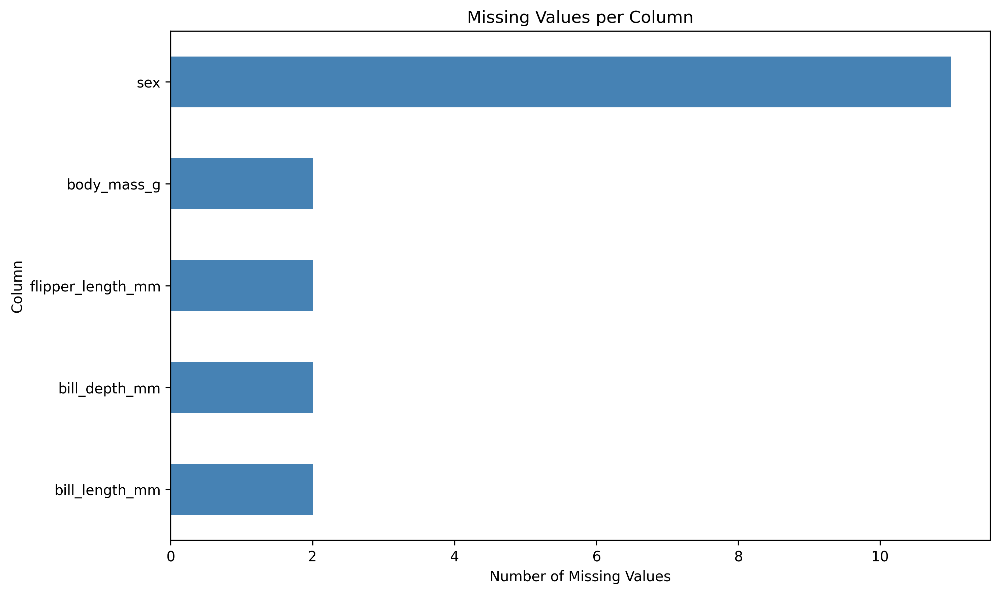
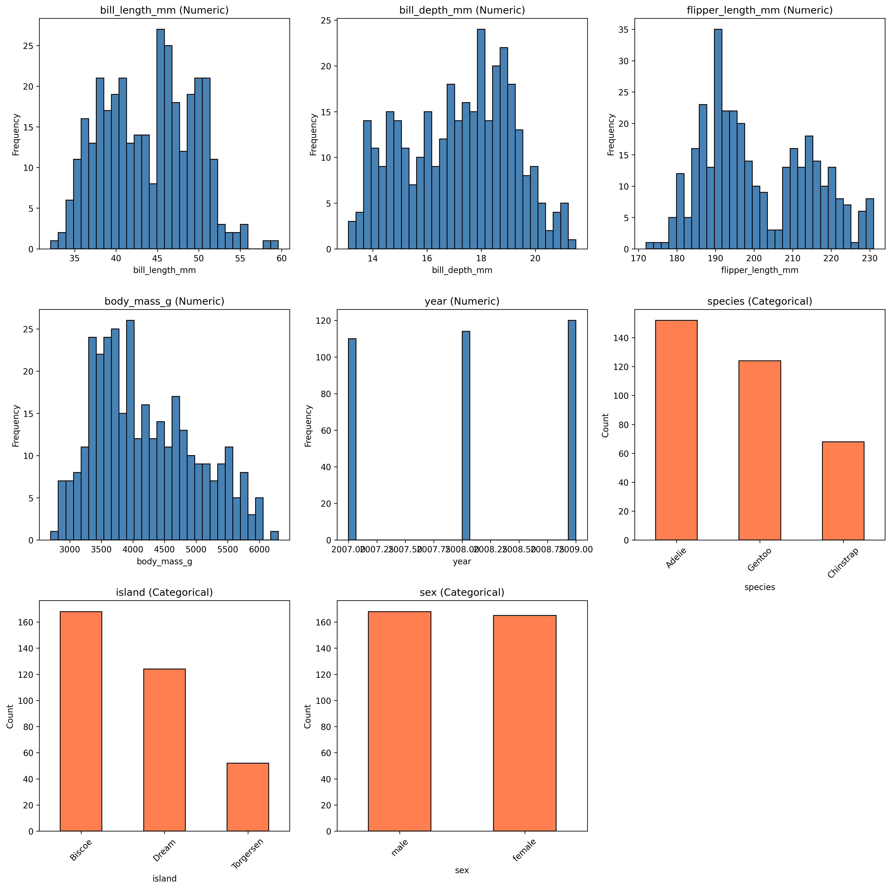
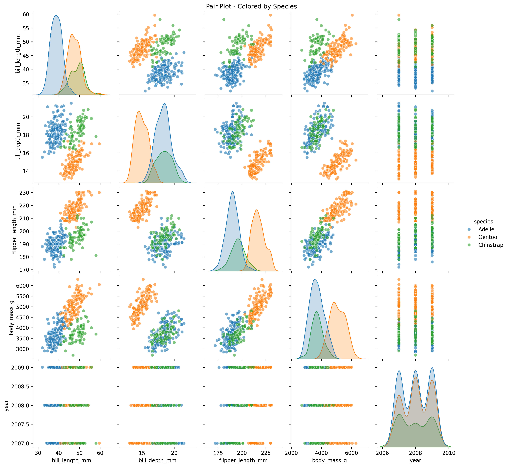
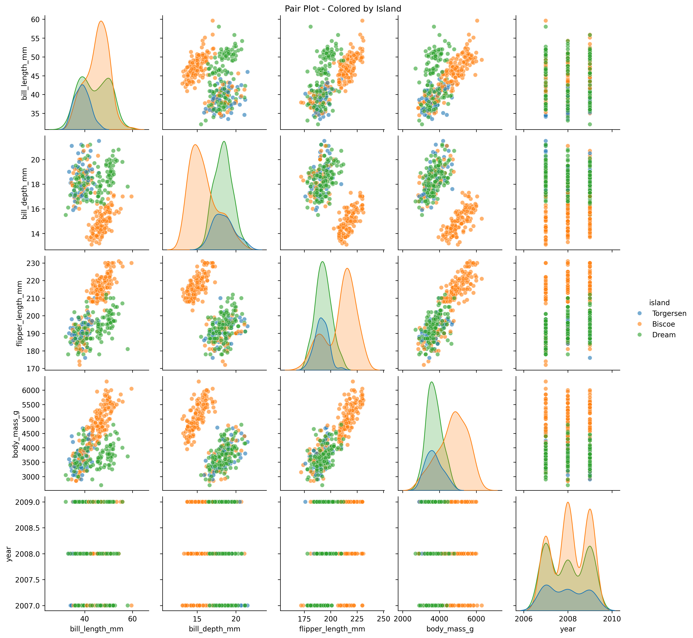
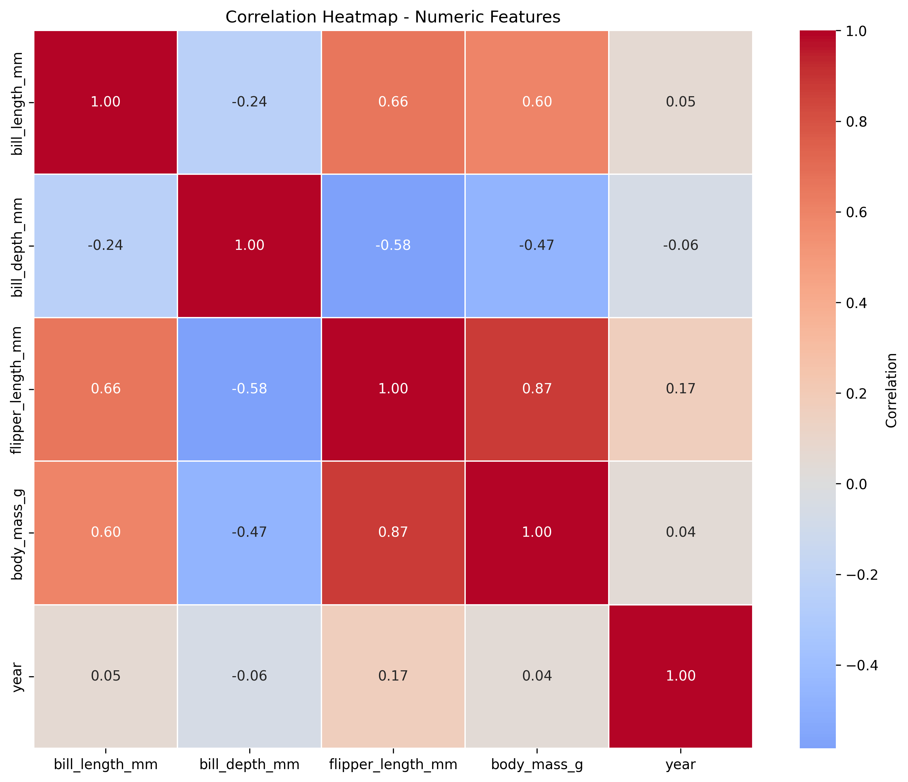
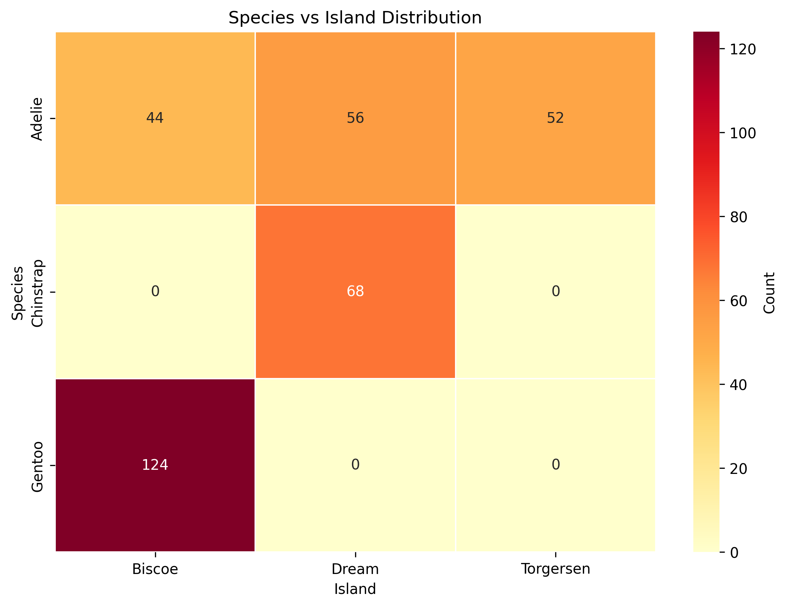

# Penguins Data Analysis (EDA)

Exploratory Data Analysis of the Penguins dataset from Kaggle.

## Dataset Overview

- **Records**: 344 penguins
- **Columns**: 9 (ID, species, island, measurements, sex, year)
- **Missing Values**: 2-11 across some columns
- **Species**: Adelie, Gentoo, Chinstrap
- **Islands**: Torgersen, Biscoe, Dream

## Visualizations Generated

### Plot 1: Null Values Histogram (`01_null_values.png`)

- Shows missing values count per column. 



---

### Plot 2: Column Distributions (`02_column_distributions.png`)

- Shows column different values.



---

### Plot 3: Pair Plot by Species (`03_pairplot_species.png`)

- Scatter plots of all numeric feature pairs
- Colored by penguin species
- Diagonal shows histograms for each numeric feature
- Reveals species-specific clustering patterns



---

### Plot 4: Pair Plot by Island (`04_pairplot_island.png`)

- Scatter plots of all numeric feature pairs
- Colored by island
- Shows if penguins from different islands have distinct characteristics



---

### Plot 5: Correlation Heatmap (`05_correlation_heatmap.png`)

- Correlation matrix of numeric features



---

### Plot 6: Species vs Island Distribution (`06_species_island_correlation.png`)

- Correlation between species and their island.



---


## Key Insights

- **Species Differences**: Different penguin species have distinct measurements
- **Measurements Correlate**: Bill length, depth, flipper length, and body mass are related
- **Bill** - Bill length and depth, share the lowers (abs) correlation - which is surprising 
- **Island Distribution**: Almost each specie prefer one island, except one specie which as evenly distribution over all island.

## Files

- `analysis.py` - Main analysis script that generates all visualizations
- `penguins.csv` - Dataset file
- `plots/` - Directory containing all generated visualizations

## Running the Analysis

```bash
python analysis.py
```

This will generate all the visualization files in the `plots/` directory.


## Requirements

Install `pip install -r requirement.txt`

```
pandas
seaborn
matplotlib
kagglehub   # (Optional: for updating data)
```