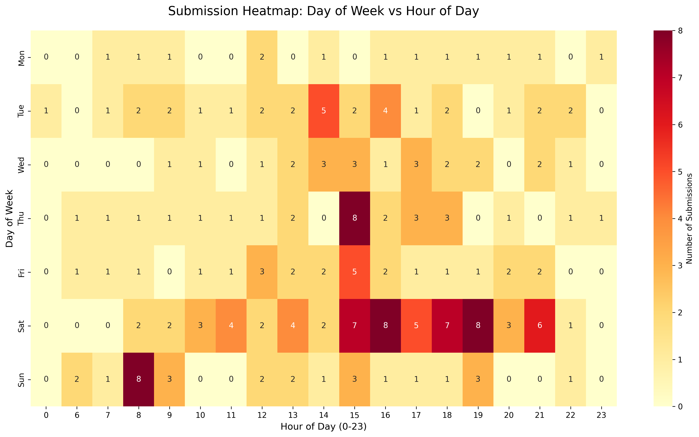
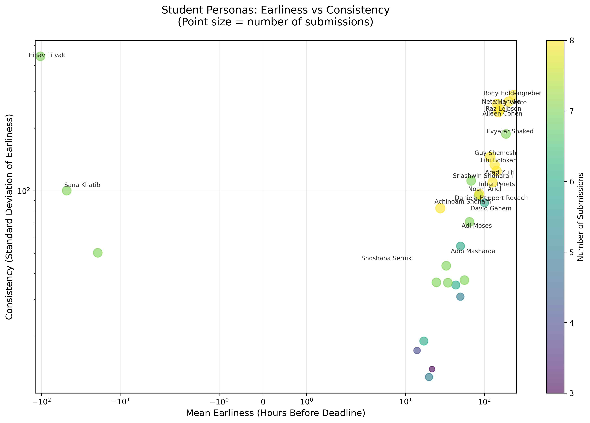
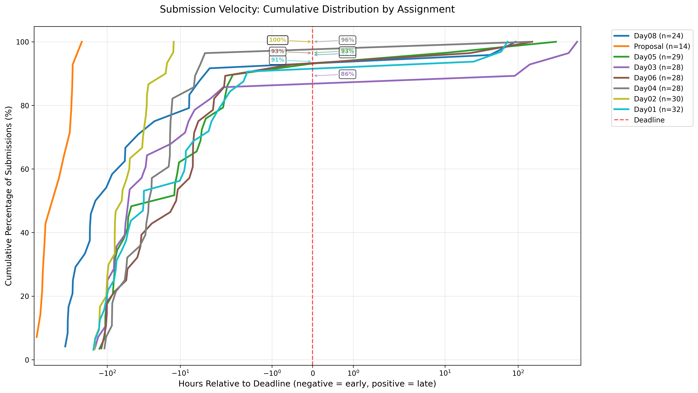
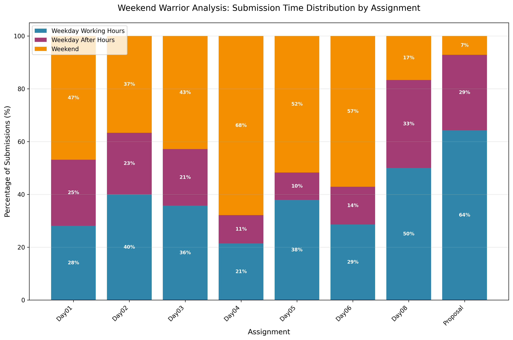
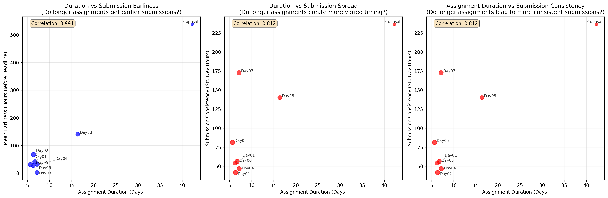

# Course Assignment Submission Analysis

This analysis examines student submission patterns for Python course assignments using data from assignments, submissions, and class schedules.

## Overview

**Dataset Summary:**

- **8 assignments** analyzed (Day01-Day08)
- **199 submissions** from 36 students
- **87.4%** of submissions were late (after deadline)
- **57.8%** of submissions occurred on weekends
- Mean submission time: **147.2 hours after deadline**

---

## Visualizations

### 1. Submission Heatmap: Day of Week vs Hour of Day

**What it shows:** A 2D grid where intensity represents submission frequency by day and hour.

**Key Insights:**

- **Peak submission times:** Weekend evenings and late nights
- **Minimal activity:** Weekday working hours (9 AM - 5 PM)
- **Popular submission hours:** 6-11 PM across all days
- Students heavily favor evening and weekend work sessions

---

### 2. Student Persona Scatter: Earliness vs Consistency

**What it shows:** Each student plotted by their average submission timing and consistency (standard deviation). Point size indicates number of submissions.

**Key Insights:**

- **Most students cluster** in the late submission zone
- **Few "early birds"** exist who consistently submit before deadlines
- **High variability** in submission patterns among students
- **Inconsistent submitters** show high standard deviation in timing

---

### 3. Submission Velocity: Cumulative Distribution Function (ECDF)

**What it shows:** Cumulative percentage of class submissions over time relative to deadline. Each line represents one assignment.

**Key Insights:**

- **Steep curves after deadline** indicate most students submit late
- **Assignment difficulty varies:** Some assignments show earlier completion
- **Consistent pattern:** Most assignments see 60-80% completion well after deadline
- **No assignment** achieved majority early submission

---

### 4. Weekend Warrior: Submission Time Distribution

**What it shows:** 100% stacked bar chart showing proportion of submissions during:

- **Weekday Working Hours** (9 AM - 5 PM, Mon-Fri)
- **Weekday After Hours** (evenings/nights, Mon-Fri)
- **Weekend** (Saturday-Sunday)

**Key Insights:**

- **Weekend dominance:** Most assignments see 50-70% weekend submissions
- **Minimal weekday work:** Very few students work during business hours
- **After-hours preference:** Weekday evenings popular but less than weekends
- **Consistent pattern:** All assignments show similar time distribution

---

### 5. Assignment Release Timing Analysis

**What it shows:** Analysis of when assignments are released relative to class sessions.

**Key Insights:**

- **Assignments typically released** within 24-48 hours after class
- **Consistent timing:** Most releases follow a predictable schedule
- **Correlation with classes:** Strong relationship between class timing and assignment publication

---

### 6. Time Allocation Patterns

**What it shows:** Four-panel analysis examining relationships between assignment duration and submission patterns.

**Key Insights:**

- **Duration correlation:** Longer assignments don't necessarily lead to earlier submissions
- **Relative timing:** Students tend to submit at similar relative points regardless of assignment length
- **Consistency varies:** Some assignments create more varied submission patterns than others
- **Time scaling:** Students don't effectively scale their work time with assignment duration

---

## Key Findings

### Behavioral Patterns

1. **Strong weekend preference** - Students overwhelmingly choose weekends for assignment work
2. **Late submission norm** - Nearly 90% of work is submitted after deadlines
3. **Evening/night preference** - Peak activity occurs 6-11 PM across all days
4. **Minimal business hours activity** - Very few students work during traditional work hours

### Educational Implications

1. **Deadline effectiveness** - Current deadlines don't motivate early completion
2. **Time management challenges** - Students struggle with planning and time allocation
3. **Work-life balance** - Heavy reliance on personal time (evenings/weekends) for coursework
4. **Assignment pacing** - Duration doesn't significantly impact submission timing patterns

### Recommendations

1. **Flexible deadlines** - Consider soft/hard deadline structures
2. **Time management workshops** - Address planning and scheduling skills
3. **Progress check-ins** - Implement milestone-based progress tracking
4. **Peak support hours** - Align instructor availability with student activity patterns

---

## Technical Details

**Analysis performed using:**

- Python 3.10 with pandas, matplotlib, seaborn, numpy
- Date parsing for multiple datetime formats
- Statistical correlation analysis
- Empirical cumulative distribution functions (ECDF)

**Files analyzed:**

- `assignments.csv` - Assignment details and deadlines
- `subjects.csv` - Student submission timestamps
- `classes.csv` - Class schedule information

**Generated:** January 7, 2026
